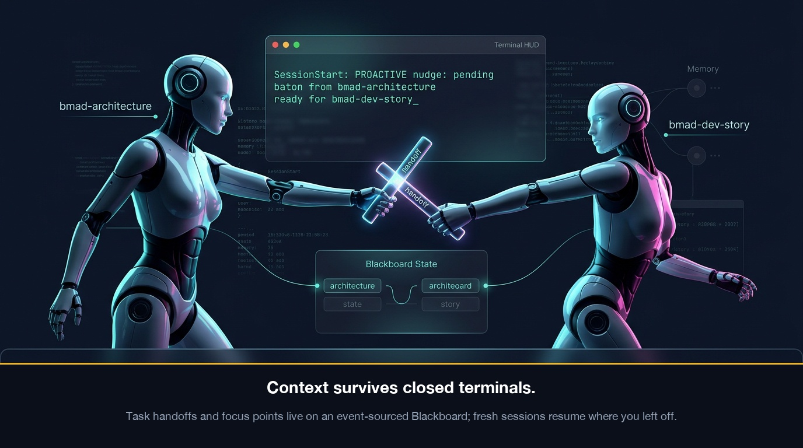
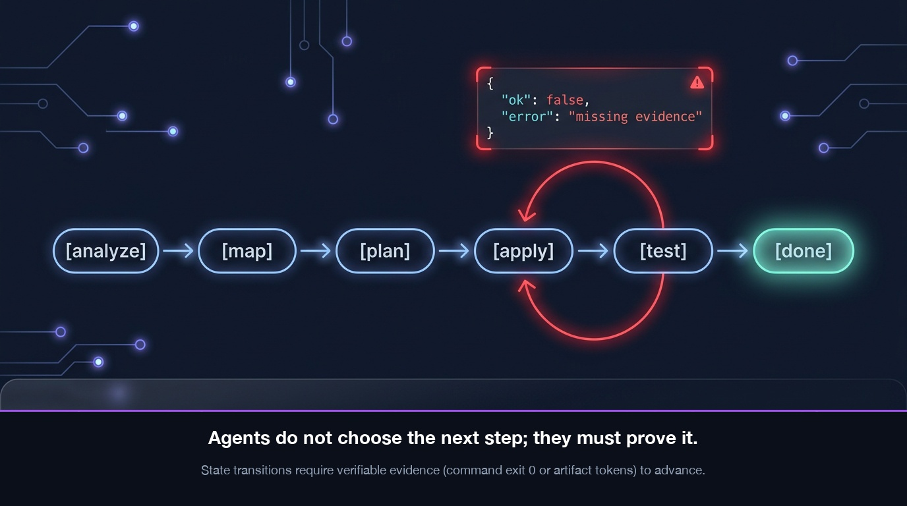

# metodoloji

    

**A methodology plugin that applies approval gates to coding-agent actions through supported runtime hooks.**

For **[CC]**, **OpenHands**, **OpenCode**, and **Hermes**: a 6-stage record chain (`E → IR → SP → S → QR → PR`), hooks that gate writes/commits/deploys using approved records, declared structural scope, and configured policy, 48 skills, a blackboard that carries context across sessions, and a declared workflow engine. Compatible with the [BMad Method](https://github.com/bmad-code-org/BMAD-METHOD).

---

## What you get

- **A mechanical experiment gate.** Code is written only from a record that the gate itself measured and signed (`APPROVED` + a `GATE-OK-...` token). No record, no write — `DENY`, not a lecture.
- **Experiments and contracts are different claims.** A stochastic claim is an `experiment`; a deterministic test over a closed input set is a `contract` that must prove 100% of its enumerated cases and is not dressed up with sampling statistics. `- **Record Kind:**` makes the choice explicit.
- **A chain that unlocks itself.** `E → IR → SP → S → QR → PR`: research, readiness, sprint, story, quality, production readiness. Each link checks the one before it, on commit and on deploy.
- **Rigor tiers, not one-size ceremony.** A story declares `- **Rigor Tier:** 1|2|3`. Tier 1 (trivial/doc/hotfix) needs QR + regression evidence; Tier 2 (feature/refactor) adds the story record, AC metadata and unit tests; Tier 3 (probabilistic/security/core/ML) keeps the full chain. The tier never relaxes the code guard or the QR requirement; absent or malformed values fall back to Tier 3.
- **48 skills, 42 customization TOMLs.** PRD, architecture, story, sprint, dev, code review, test/QA, retro and correction workflows for product projects — each skill's defaults live in its own `customize.toml`, overridable per project.
- **Context that survives sessions.** The blackboard (`write --hot`, run lists, handoffs, canvases) carries focus and pending batons between skills and across windows. Storage is SQLite by default (one WAL database, transactional read-modify-write); set `blackboard_backend = "json"` for the legacy snapshot + event-log files.
- **One manifest, four runtimes.** A single `hooks/hooks.json` serves [CC] and OpenHands; OpenCode and Hermes join through adapters that call the same Python hook engine. The decision logic is shared; tool coverage and interception points differ by runtime. See [`docs/OPENCODE.md`](docs/OPENCODE.md) and [`docs/HERMES.md`](docs/HERMES.md).
- **Declared workflow engine.** Multi-stage processes run as a deterministic state machine that refuses a stage without evidence (`hooks/workflow/`, builtin specs under `hooks/workflow/builtin/`).

## How it works

```
  E ──────── IR ──────── SP ──────── S ──────── QR ──────── PR
  experiment readiness   sprint     story      quality     production
  measured by the gate   inputs     tasks      ≥80% cov    rollback
      │
      └─── guard: only a VERIFIED experiment opens a code scope
```

Three hooks guard the three moments that matter:

| Hook | Watches | Behaviour |
|---|---|---|
| **guard** | Adapter-mapped write and shell calls | No covering VERIFIED experiment → `DENY` in hard mode; warn in soft mode |
| **quality** | A mapped terminal command recognized as `git commit` | Chain check `IR → QR → SP`, plus story metadata and QR coherence |
| **deploy** | A mapped terminal command matching the deploy-command rules | Chain check `IR → QR → SP → PR` |

The commit/deploy chain is tier-aware: Tier 1/2 stories skip the upstream IR/SP/PR planning records by policy, but every tier still requires its QR. Legacy stories without a `Rigor Tier` field keep the full chain.

New drafts are generated through the schema-checked CLI, not hand-written:

```bash
python3 {metodoloji-root}/scripts/create-record.py --kind experiment --id E-119 --title "..." \
  --theory "..." --hypothesis 'H-119: "x >= 0.90"' --metrics "x >= 0.90" \
  --design "..." --scope "src/**" --lineage none \
  --raw-samples docs/experiments/E-119/raw/samples.jsonl
python3 {metodoloji-root}/scripts/create-record.py --check docs/experiments/E-119.md
```

The CLI refuses a draft that violates its schema and stamps `- **Record Schema:** metodoloji.record/v1`; the gate remains the only writer of the decision, and refuses an experiment/contract draft that lacks the attestation.

The **self-modification rule** distinguishes a methodology checkout from ordinary product code by a marker set, not just path equality with the loaded engine. Editing a checkout is therefore not blocked by an experiment approved by an installed copy of the very gate being edited; `src/`, `lib/` and other product paths stay gated.

What it looks like in practice:

```text
# the agent wants to write code, but no experiment covers it
Write src/auth/jwt.py
  → guard: DENY — "No approved experiment record"
  → the agent opens E-001, runs the gate, gets APPROVED, re-verifies
  → the same write now passes, and only for the approved scope
```

`Stop` is **report-only** — it summarises the session (in-progress stories, this window's writes, a pending handoff) and never blocks.

### Cross-session memory and baton handoffs

The blackboard carries focus, run lists, and pending handoffs across skills and windows so context is preserved when you restart your terminal:



### Declared workflow engine

Multi-stage processes run as a deterministic state machine that refuses transitions without verifiable evidence (`command exit 0` or artifact tokens):



## Requirements

| Requirement | Minimum | Note |
|---|---|---|
| Python | 3.11+ | `tomllib` for the TOML layers; the engine resolves `python3 → python → py` |
| OpenHands / [CC] | current | plugin + hook API support |
| OpenCode | v2 | third runtime — a TypeScript bridge (`opencode-plugin/`) spawns the same Python engine |
| Hermes Agent | current | fourth runtime — `plugin.yaml` + `pre_tool_call`, gates run in the gateway process ([`docs/HERMES.md`](docs/HERMES.md)) |
| Git | 2.x | record and commit gating |
| Shell | POSIX `sh` | Git Bash is enough on Windows |

The Python engine runs from the plugin checkout; this repository is not published as an installable Python library. `pyproject.toml` carries project metadata and test configuration. OpenCode's npm package is a runtime bridge and still needs access to the methodology checkout that contains the Python engine.

## Quick start

You don't operate this plugin by hand — you **ask your agent**. Install once, then prompt.

**1. Install** ([CC]):

```bash
/plugin marketplace add https://github.com/metodoloji/metodoloji
/plugin install metodoloji@metodoloji
```

<sub>or OpenHands:</sub>

```python
from openhands.sdk.plugin import install_plugin
install_plugin("github:metodoloji/metodoloji")
```

<sub>or OpenCode (V2):</sub>

```jsonc
// opencode.jsonc — a checkout keeps hooks/engine/ reachable
{ "plugins": ["./opencode-plugin"] }
```

> The Git/npm forms install only `opencode-plugin/`; point
> `METODOLOJI_PLUGIN_ROOT` at a metodoloji checkout so the bridge finds the
> engine. Details: [`docs/OPENCODE.md`](docs/OPENCODE.md).

<sub>or Hermes Agent:</sub>

```bash
hermes plugins install metodoloji/metodoloji
hermes plugins enable metodoloji
```

> The plugin ships `plugin.yaml` + `register(ctx)` at the repo root, so the
> Git install is the whole package — 5 tools, 6 hooks, the full skill catalog
> and 6 slash commands. Details, limits and the fail-closed contract:
> [`docs/HERMES.md`](docs/HERMES.md).

**2. Set up your project** (once):

> Run `/metodoloji:init`, then `/metodoloji:gate-setup`, then `/metodoloji:audit`. After a plugin update, init can be re-run safely to add newly shipped directories/templates; it never replaces existing project files.

The agent installs the `docs/` record skeleton (one time, never overwrites), creates your machine-local gate key (one time per machine, never printed), and reports project health.

**3. Describe what you want built:**

> Add JWT authentication to the API under `src/auth/`.

The agent picks the skills, writes the experiment, and runs the measurement gate. Product code requires a verified scope; measurement benches can be staged under an undecided record, while non-measurement structural work must use a declared structural scope. If a write is denied, the guard returns the reason so the agent can correct the record or scope.

**4. Keep going through the chain:**

> Continue with IR, sprint plan, story, then implement. Open a QR before committing.

The agent advances `E → IR → SP → S → code → QR → commit → PR → deploy`, verifying each link.

## The five commands

| Tell the agent | What happens |
|---|---|
| `/metodoloji:init` | Installs the `docs/` skeleton + templates; safe re-runs add only missing assets and preserve existing files |
| `/metodoloji:gate-setup` | Creates the machine-local gate key (one time per machine; never shared, never in the repo) |
| `/metodoloji:verify` | Checks one experiment record: `VERIFIED` (code allowed), `FORGED`, `REJECTED` or `ADVISORY-BLOCK` |
| `/metodoloji:audit` | Full health check: plugin integrity, bridge wiring, record-chain gaps, gate modes |
| `/metodoloji:add <source>` | Analyzes a repository URL, docs site, or local PDF/Markdown source against this project and registers a complete `docs/research/external/<slug>/context.md`; the analysis is agent-led, scaffold/validation/indexing are mechanical |

**How a task flows:** you state the goal → the agent researches and plans with skills (`bmad-prd`, `bmad-architecture`, `bmad-sprint-planning`…) → it opens an experiment, measures, gets `APPROVED` → implements inside the verified scope → records the quality review → commits. Multi-step work is carried over the blackboard (`write --hot`, run lists, handoffs), so context survives across sessions.

## Two rules that save you pain

- **Never touch the gate key.** Don't print, copy, or `cat` it — the guard denies key references on purpose. Key problems are solved with `/metodoloji:gate-setup`, not with the shell.
- **`FORGED` on a teammate's record is normal.** Keys are machine-local by design; each machine re-runs the measurement under its own record instead of sharing keys.

And one clarification: methodology **output** (records, artifacts) is written to *your* project under `docs/`; the plugin itself is never written to while it runs in someone else's project.

## Verify your install

Every check runs offline, with no credentials:

```bash
python -m pytest -q                       # 1,900+ tests: hook engine, bridges, skills
sh scripts/check-plugin.sh                # plugin structure audit
sh scripts/check-custom.sh                # bridge TOML static audit
sh scripts/check-methodology.sh           # record format audit
sh scripts/check-techdebt.sh              # tech-debt inventory audit
python scripts/check-handoff.py           # handoff wiring lint
python3 {metodoloji-root}/scripts/check-triggers.py          # trigger/description collision audit
python3 {metodoloji-root}/scripts/external-context.py check --project-root . --strict
```

The seven checks above (pytest plus the six audits) are the local gate every change must clear before it lands.

`scripts/bench/` holds the measurement instruments — one closed-set bench per claim, each with a `--broken` control arm that must score below the threshold (a bench that cannot tell working code from broken code is not evidence). CI runs two separate workflows. `.github/workflows/quality.yml` runs the Python suite and the plugin/record audits on pull requests, plus the OpenCode bridge tests in their own Node job. `.github/workflows/release-numbers.yml` is release-number only: it writes no version and creates no commit — the number is written into the commit that owns it by the committed pre-commit hook (install once per clone: `git config core.hooksPath .githooks`), and the pipeline verifies each pushed commit's tree against the number its position owns, then publishes `vX.Y.Z`. A wrong number is a red job naming the number it should be, never a bot commit. Negative gate checks remain available locally with `{metodoloji-root}/scripts/check-plugin.sh --negtest` and `{metodoloji-root}/scripts/check-custom.sh --negtest`.

## Project layout

```
metodoloji/
├── hooks/engine/        # shared hook engine; gate policy and blackboard domains are split into modules
├── hooks/hooks.json     # generated dispatch manifest ({metodoloji-root}/scripts/sync-hooks-json.py --write)
├── skills/              # 48 skills (native bodies)
├── config.toml          # the plugin config (gate policy, soft/hard)
├── hooks/workflow/      # the workflow kernel: builtin specs, evidence, run state
├── templates/           # _template_E/IR/SP/QR/PR/S/PM/BD/C/STRUCT + README/tech-debt/external-context
├── commands/            # /metodoloji:init, gate-setup, verify, audit, add (.md)
├── scripts/             # static checks, record generators, bench harness, sync-hooks-json
└── docs/                # engine notes, record templates, design notes, native outputs
```

## Documentation

| Guide | Audience |
|---|---|
| [`docs/HERMES.md`](docs/HERMES.md) | Hermes Agent port — install, tools/hooks/commands, runtime mapping, known limits |
| [`docs/OPENCODE.md`](docs/OPENCODE.md) | OpenCode bridge — install, tool mapping, interception coverage |
| [`docs/design/experiment-integrity.md`](docs/design/experiment-integrity.md) | Why the experiment gate is mechanical, and where it can still be fooled |
| [`docs/design/structural-scope.md`](docs/design/structural-scope.md) | Declared scope for work that is not measured by a bench |
| [`docs/development/README.md`](docs/development/README.md) | The record types and how the chain uses them |
| [`SECURITY.md`](SECURITY.md) | Security architecture + vulnerability reporting |

## Contributing

Issues and PRs are welcome — across the skills, the hook engine, the workflow kernel and the docs. Every change lands with a record: open an experiment, measure it with a bench that has a working control, get it `APPROVED`, then implement inside the verified scope. Run the checks above before opening a PR.

## License

MIT — see [LICENSE](LICENSE).

Built on [BMAD-METHOD](https://github.com/bmad-code-org/BMAD-METHOD) by BMad Code (MIT). "BMad" and "BMAD-METHOD" are trademarks of BMad Code, LLC — see [TRADEMARK.md](https://github.com/bmad-code-org/BMAD-METHOD/blob/main/TRADEMARK.md). Not affiliated with or endorsed by BMad Code, LLC. The `ATTRIBUTION` section at the end of `LICENSE` credits BMAD-METHOD and its trademark owner.
